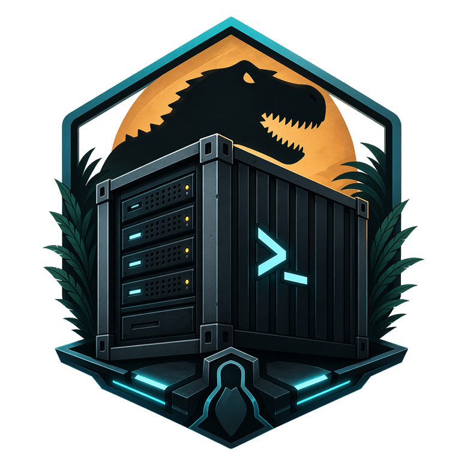

<p align="center">
  
</p>

# ARK: Survival Ascended Linux Server

Host a dedicated **ARK: Survival Ascended** world on your Linux machine so your
group can play even when you're offline. Docker Compose runs the Windows game
server through GE-Proton. The image installs the game and Proton on first
launch and checks for game updates on subsequent launches by default.

- **Restarts while people are playing.** The built-in scheduler can warn players
  in chat before a planned restart. On shutdown the supervisor asks ARK to save
  the world through RCON. If ARK receives the request but its reply is lost,
  the supervisor still allows time for the save. The supplied configuration
  schedules a daily restart.
- **Maps and mods in one place.** Pick a world by name and add CurseForge mod
  IDs in Compose. For a group that plays across maps, the included second-server
  example shows how to share character and creature transfers between worlds.
- **Administration from the host.** The bundled `asa-ctrl` tool can send chat
  messages, save the world and check whether ARK answers RCON. It reads the
  admin credentials from the server configuration.

## Quick start

### 1. Prepare the host

Use a Linux x86-64 (Intel or AMD) host with Docker and the Compose plugin.
Budget roughly 13 GB of RAM and 31 GB of disk for one server as a starting
estimate. Allow extra space for updates, mods and backups. On ARM64, follow
the [experimental setup](SETUP.md#arm64-experimental) to select the correct image.

Run these commands on the host to get the configuration for the published image:

```bash
mkdir asa-server && cd asa-server
wget https://raw.githubusercontent.com/JustAmply/ark-survival-ascended-server/main/docker-compose.yml
wget https://raw.githubusercontent.com/JustAmply/ark-survival-ascended-server/main/.env.example
cp .env.example .env
```

### 2. Set the password and choose your world

In `.env`, set `ASA_SERVER_ADMIN_PASSWORD` to a unique password and keep it
private. To require a password for players to join, also set
`ASA_SERVER_PASSWORD` in the service's Compose environment.

In `docker-compose.yml`, find `services → asa-server-1 → environment`.
Add `ASA_SESSION_NAME` so friends can find the server. Keep the existing
`ASA_MAP` for The Island or replace its value using the [map list](SETUP.md#choose-a-map).

```yaml
      ASA_SESSION_NAME: "Our Weekend ARK"
      ASA_MAP: TheIsland_WP
```

The example restarts the game at **04:00 Europe/Berlin**. Adjust
`SERVER_RESTART_CRON` and `TZ` for your group, or remove `SERVER_RESTART_CRON`
to disable scheduled restarts.

### 3. Start the server and join

```bash
docker compose up -d
docker compose logs -f asa-server-1
```

The first launch downloads the game and loads the world. Press Ctrl+C to leave
the log view while the server keeps running. Run `docker compose ps` to check
its health. With the supplied settings, `healthy` means ARK answers RCON.

For players connecting over the internet, allow **UDP 7777** through the host
firewall and, behind a home router, forward that port to the Docker host. RCON stays inside
the container network by default. For an external admin client, see the
[SSH tunnel setup](SETUP.md#networking).

In ARK, open **Unofficial**, enable **Show Player Servers** and search for
your session name. If it doesn't appear, start with the
[server visibility checks](FAQ.md#server-is-not-visible).

## After your first session

| What you want to do | How |
| --- | --- |
| Stop the server for the night | Run `docker compose stop -t 300` to allow time for saving. Use `docker compose start` to bring it back. |
| Apply a map, password or settings change | Edit the configuration and run `docker compose up -d -t 300`. See the [settings reference](SETUP.md#server-configuration). |
| Update the container image | Run `docker compose pull`, then `docker compose up -d -t 300`. The image handles game updates separately. |
| Back up your world | Saves live in Docker volumes and survive container recreation. Follow [backup and recovery](docs/backups.md) before switching worlds or removing volumes. |
| Add mods or a second world | Follow [mods and custom maps](SETUP.md#mods-and-custom-maps) or the [multi-server cluster guide](SETUP.md#multi-server-clusters). |

For more, see the [administration guide](SETUP.md), [troubleshooting](FAQ.md)
or the [development guide](docs/development.md).

## Support and credits

Report bugs through [GitHub Issues](https://github.com/JustAmply/ark-survival-ascended-server/issues)
and ask questions in [GitHub Discussions](https://github.com/JustAmply/ark-survival-ascended-server/discussions).

This project rewrites the original Ruby tools in dependency-free Python.
Thanks to [mschnitzer](https://github.com/mschnitzer/ark-survival-ascended-linux-container-image)
for the original image, [GloriousEggroll](https://github.com/GloriousEggroll/proton-ge-custom)
for GE-Proton, and [cdp1337](https://github.com/cdp1337/ARKSurvivalAscended-Linux)
for Linux installation guidance.
